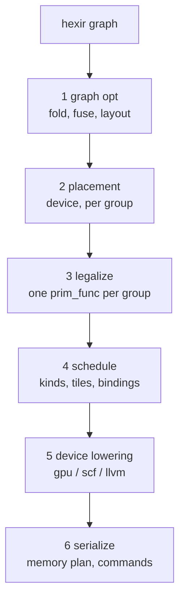

# The plan

The other pages in this section are a catalogue: what the three big compilers
do, and where each idea would live here. This page is the plan — the order to
build it in, and the structure that keeps it from turning into thirty unrelated
passes.

The headline: **Hexir does not need a new architecture.** `hexir.call_tir`
plus module-scope `hextir.prim_func` is already the shape TVM's Relax uses.
What is missing is phase separation and a policy layer.

## Fix this before anything else

`hexir-lower-to-tir` currently decides three unrelated things in one pass.
From `makeLoop` in `compiler/Conversion/HexirToTIR/HexirToTIR.cpp`:

```cpp
kind = device == "cuda" ? "thread_binding" : "parallel";
```

That line conflates **what the kernel computes**, **where it runs** and **how it
is scheduled**. It is the reason you cannot experiment with schedules today: to
try a tiled matmul you have to edit the lowering.

Every scheduling framework separates these three, and it is not a matter of
taste. It is what makes a schedule a value you can generate, compare and search
over rather than code you rewrite.

So the split is:

* `hexir-lower-to-tir` emits a **correct but unscheduled** kernel. Every loop
  `serial`, no thread bindings, no block-size heuristic. It answers only "what
  does this compute".
* A new `hextir-schedule` pass reads the `device` attribute, the shapes and a
  hardware model, and rewrites the loop kinds. It answers "how does this device
  do it".

`chooseBlockSize` moves out of the lowering and becomes part of a rule. That is
the whole unlock, and everything below assumes it.

## Phases

Six phases, each a directory, each with a `--compile-to=` phase so it stays
inspectable. The rule that prevents clutter: **a pass in phase N may not need
knowledge that only phase N+1 has.**

| Phase | Rewrites | Does |
| --- | --- | --- |
| 0 build / parse | — | the `hexir` graph |
| 1 graph optimization | hexir → hexir | folding, const-eval, the fusion decision, layout |
| 2 placement | annotate | `device`, on groups rather than single ops |
| 3 legalize to kernels | hexir → hextir | one prim func per fused group, **unscheduled** |
| 4 schedule | hextir → hextir | loop kinds, tiles, bindings, staging |
| 5 device lowering | hextir → gpu / scf | NVVM, CUBIN, LLVM |
| 6 serialize | — | memory plan, command list, runtime |

The CLI now names these directly: `--compile-to=input|graph|place|kernel|device|artifact`,
with `-emit=` reduced to the output format. `schedule` and `host` are missing
from that list on purpose — the passes behind them do not exist yet, and a phase
that prints the wrong IR is the bug the restructuring removed.

Phase 1 sits *before* placement, and phase 2 annotates groups rather than
individual operations. Fusing after placement means a fused group can straddle
two devices and has to be taken apart again; Relay puts `FuseOps` before
partitioning for exactly this reason.



## Three pieces of infrastructure

Build these three and individual optimizations become twenty-line additions
instead of new passes. Skip them and every optimization is a special case.

### 1. A fusion-kind interface, in TableGen

This is the difference between organized and cluttered. Without it every fusion
pass grows an `isa<AddOp, ReluOp, MulOp, …>` list, and soon there are five
copies of that list drifting apart.

Give each op a category the way Relay does — `elemwise`, `broadcast`,
`injective`, `reduction`, `out_elemwise_fusable` (matmul, conv), `opaque` —
declared once, next to the op:

```tablegen
def ReluOp : Hexir_Op<"relu",
    [Pure, DeclareOpInterfaceMethods<FusionKindInterface>]>
```

The fusion pass is then generic, and a new op costs one line rather than an
edit in every pass. There is already a precedent for the pattern in this
codebase: `ShapeInferenceOpInterface` is exactly this.

### 2. Fuse before generating kernels, never after

TVM splits `FuseOps` (graph level) from `FuseTIR` (merging the loop nests)
because it has to — its prim funcs may be handwritten or library-provided.
Hexir has no such constraint, and merging two generated loop nests is far harder
than generating one fused nest. So:

* `hexir-fuse-ops` — a dominator-based grouping analysis over the fusion kinds.
  Output is a group id per op.
* `hexir-lower-to-tir` — extend `lowerOne` to take a *group* rather than an op,
  and emit one prim func whose body chains the group's scalar bodies.

`buildElementwiseBody` already takes an `emit` callback for the scalar body, so
fusing an elementwise chain is composing those callbacks. That is most of the
work for the common case, and it is what turns `linear → add → relu` into one
kernel.

Start with a group **attribute**, not a region op. Promote to a region op only
when there is a reason to optimize *across* groups — otherwise it is a verifier
to maintain for no benefit.

### 3. Schedule primitives as a library, rules as policy

Three layers. Keeping them apart is what stops this becoming unmaintainable.

| Layer | What it is | Where it lives |
| --- | --- | --- |
| Primitives | `split`, `tile`, `reorder`, `bind`, `unroll`, `cacheRead` — plain C++ functions that rewrite a `hextir.for` nest. **Not passes.** | `compiler/Dialect/HexTIR/Transforms/Primitives.cpp` |
| Rules | Policy: "a cuda matmul with M,N ≥ 128 gets two-level tiling, shared-memory staging, 256 threads." One object per rule, with `matches()` and `apply()`. | `compiler/Dialect/HexTIR/Transforms/Rules/` |
| Driver | One pass that walks prim funcs, picks the first matching rule, applies it. | `compiler/Dialect/HexTIR/Transforms/Schedule.cpp` |

This is TVM's structure — primitives are API, Dlight rules are policy, the pass
is a driver — and it is the right one. Adding a GEMV path for decode later is
then one new rule file rather than surgery on a lowering.

**Hardware awareness belongs in one place too.** A rule must read numbers, not
hardcode them: shared-memory size, max threads per block, warp size, SM count,
architecture. `compiler/Target/TargetInfo.cpp` currently maps op names to
supported devices; extend it, or add a `DeviceInfo` beside it. A rule that
hardcodes 256 is a rule that is wrong on the next card.

## Milestones

Sequenced so each one is independently valuable and each has an exit criterion
you cannot fool yourself about.

### M0 — make the graph slot real

- [ ] Fix the pass manager nesting: the cleanup pipeline nests on
      `hexir::FuncOp` and every program is a `func.func`, so canonicalize,
      shape inference and CSE currently run on nothing
- [ ] Three canonicalizations and one const-eval fold

*Exit: two identical constants are CSE'd, `relu(relu(x))` collapses, and there
is a test for each.* Days, not weeks.

### M1 — split the schedule out of the lowering

- [ ] `hexir-lower-to-tir` emits unscheduled kernels
- [ ] `hextir-schedule` reproduces exactly what the lowering used to produce

*Exit: `--compile-to=kernel` output is byte-identical to before, and every existing
test passes unmodified.*

The highest-leverage milestone and the safest one, because "output unchanged" is
a criterion that cannot be argued with. Do this first even though it adds no
capability.

### M2 — fusion

- [ ] The fusion-kind interface
- [ ] The grouping analysis
- [ ] Group-aware lowering

*Exit: `linear → add → relu` becomes one prim func and one `DISPATCH`;
`tools/hxb-dump.py` shows two fewer buffers; `bench/run.sh` shows the traffic
win.*

The largest performance win available at the graph level. See
[Graph transforms](graph.md) for what comes after it.

### M3 — real schedules

- [ ] The primitives library
- [ ] GEMM rules for cpu and cuda
- [ ] Dialect additions this needs: `hextir.if` for bounds guards, a memory
      space on `hextir.alloc_buffer`, a barrier op

*Exit: matmul within 1.5x of cuBLAS on the 1660 Ti, verified against the CPU
reference.*

The menu of what the rules can then do is [Kernel transforms](kernel.md).

### M4 — memory

- [ ] Slot liveness and buffer reuse, one arena, weight residency, in-place
      elementwise

Serializer and runtime work, not passes — see [Memory](memory.md) and §1D of
`TO_DO.md` for why that distinction matters.

*Exit: no device allocation in the steady-state path, and weights uploaded once
per process rather than once per call.*

### M5 — search

- [ ] Parameterize the rules
- [ ] A tuning database keyed on (op, shape, dtype, target)

*Only now.* An autotuner over unparameterized schedules has nothing to search.

## What not to build

* **No dataflow-block op.** Relax needs one because it has effects to contain.
  Every hexir compute op is `Pure` and `hexir.print` correctly is not, so MLIR's
  existing machinery already gives safe rewriting.
* **No optimization inside a conversion.** Conversions lower, passes optimize.
  The moment `HexirToLinalg` starts making fusion decisions, neither it nor the
  fusion can be tested alone.
* **No flat pass list in `Pipelines.cpp`.** Give each phase its own
  `buildGraphOptPipeline` / `buildSchedulePipeline` function. That file stays
  readable at thirty passes only if it is six calls.
* **No autotuner before M5**, and no cost model before there are parameters to
  fit.
* **No third dialect.** The two that exist are the two that are needed. The
  `ls_cpu` / `ls_gpu` mirror dialects were deleted once for being a lossy round
  trip; do not re-add that shape under a new name.

## If you only do one thing

M1. Everything else is either blocked behind it or cheaper after it, and it is a
refactor with a mechanical exit criterion. Fusion is the bigger performance win,
but doing it first means fusing into a lowering that also hardcodes the
schedule — one pass making four decisions, and no way to test any of them
independently.
